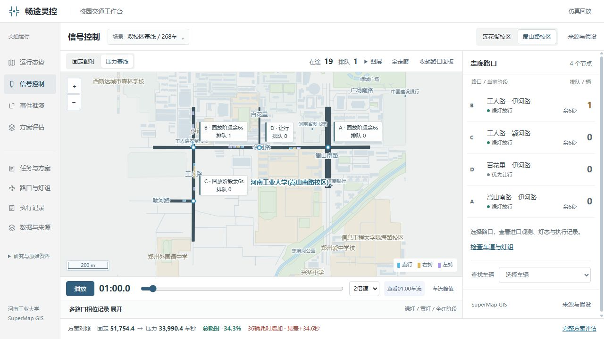

# 畅途灵控 · 交通协同研究与 GIS 决策工作台

围绕校园周边多路口交通信号协同，开展连通路网仿真、策略对照、上下游接收与回堵分析，并制作地图回放、任务与方案记录工作台。此仓库为阶段归档后整理的公开源码快照；不恢复训练、实验或自动续推。



## 实际工作

- 构建多路口连通仿真场景，跟踪同一车辆跨路口身份和全程耗时。
- 比较固定、压力与联合控制策略，保留相位、黄灯/全红、接收空间等约束。
- 展示排队、下游余量、相位时间线与逐车损益，记录局部改善及个体受损。
- 实现React地图、播放时钟、路口详情、方案比较、任务历史和证据索引。
- 使用SuperMap做投影、缓冲、相交等实际空间查询，保留Java适配源码；SDK与许可证不分发。
- 编写可迁移资源注册、路径隔离、哈希校验与持久化任务模块。

这是讯飞杯“畅途灵控”方向后续的工程与研究探索，早期随机森林/Q-Learning方案不等于当前系统已完整实现或部署。本人承担本阶段路网、控制验证与工作台开发整理；原团队方案与第三方基础工具不计为本人独立原创。

## 公开内容与运行范围

- `frontend/`：已验收设计版本的React/TypeScript源码、样式及测试。
- `scripts/`：正式离线工作台的6个Python标准库模块，包括资源与证据校验、任务存储及HTTP服务。
- `native/`：SuperMap空间查询Java适配源码；需要使用者自行取得兼容SDK与许可。
- `tests/`：仅使用临时合成文件的路径与资源完整性测试。

本仓库**不是完整可恢复演示包**。不分发大型回放、第三方交通原始数据、历史SQLite任务库、SUMO/SuperMap软件和许可、私有配置、知识库或内部研究记录。运行数据绑定与哈希缺失时，工作台模块会拒绝启动/读取，不提供虚假成功或重置历史预算的替代入口。该截图为2026-10-29已归档正式版本，不是本次重新运行的全系统截图。

## 开发检查

```powershell
cd frontend
npm ci
npm test
npm run build
```

`npm run dev`启动前端开发服务。公开副本API代理使用独立回环端口18769，不连接原项目8769服务；需要自行配置兼容API与有权使用的回放资产。仅构建前端不等于完整业务运行。

```powershell
python -m unittest discover -s tests -v
```

部分原前端测试需要未分发的实验回放文件，因此在公开配置中明确排除并保留源码。清单见[测试范围](docs/TEST_SCOPE.md)，本轮结果见[验证记录](docs/VALIDATION.md)。不会把历史241等测试数字当成当前全量测试结果。

## 已有结果的边界

交通需求主要由外地公开轨迹/研究基准迁移到本地路网，再进行仿真，不是校园现场实时交通观测。控制目标是信号配时，不提供实际车辆速度、路线或路侧设备控制。

部分开发场景有改善，但存在退化候选与受损车辆，尚未完成未见大样本泛化和现场验证。项目已阶段归档，未完成全部原参赛目标，不宣称获奖或成熟实时“AI交警”。

## 来源与权利

项目涉及SUMO、React、SuperMap及SinD/CoLight/RESCO/FLUID等资料或数据来源，各自使用与再分发条件独立。原始数据、SDK、第三方论文和许可文件不随此仓库公开。本仓库为作者自有实现的源码展示快照，尚未另行授予覆盖所有内容的统一开源许可证。
